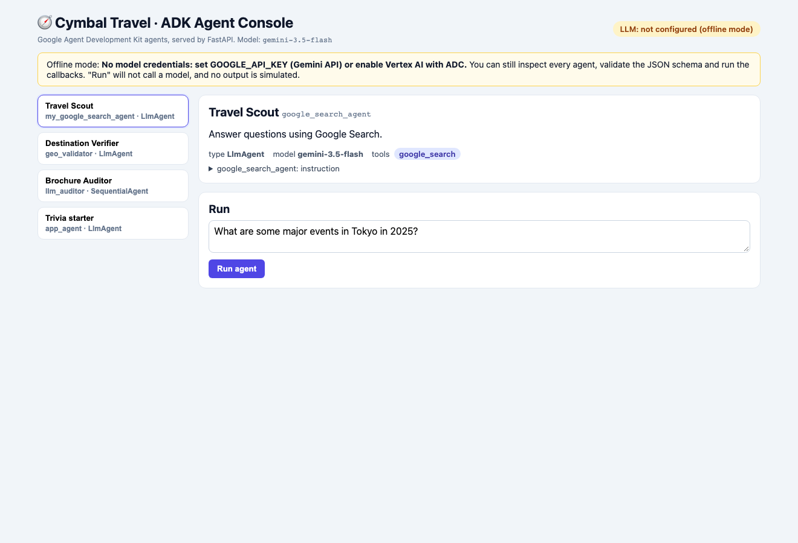
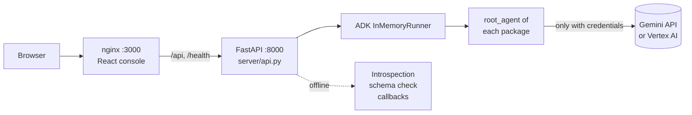
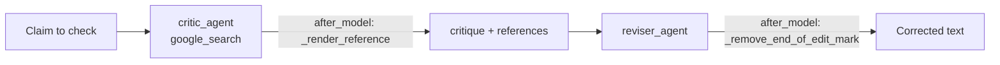
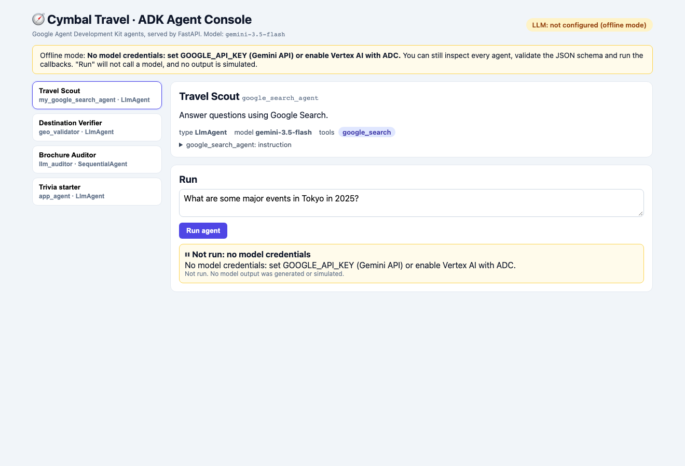
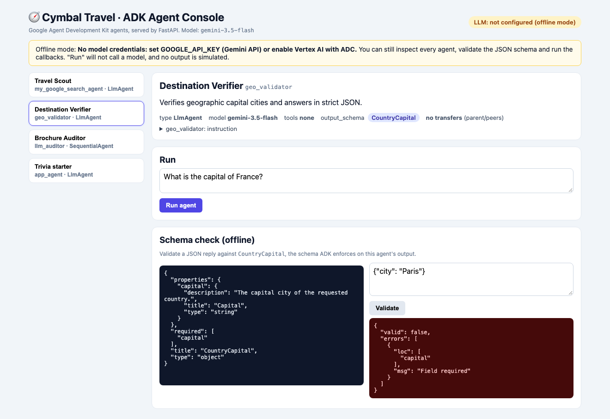
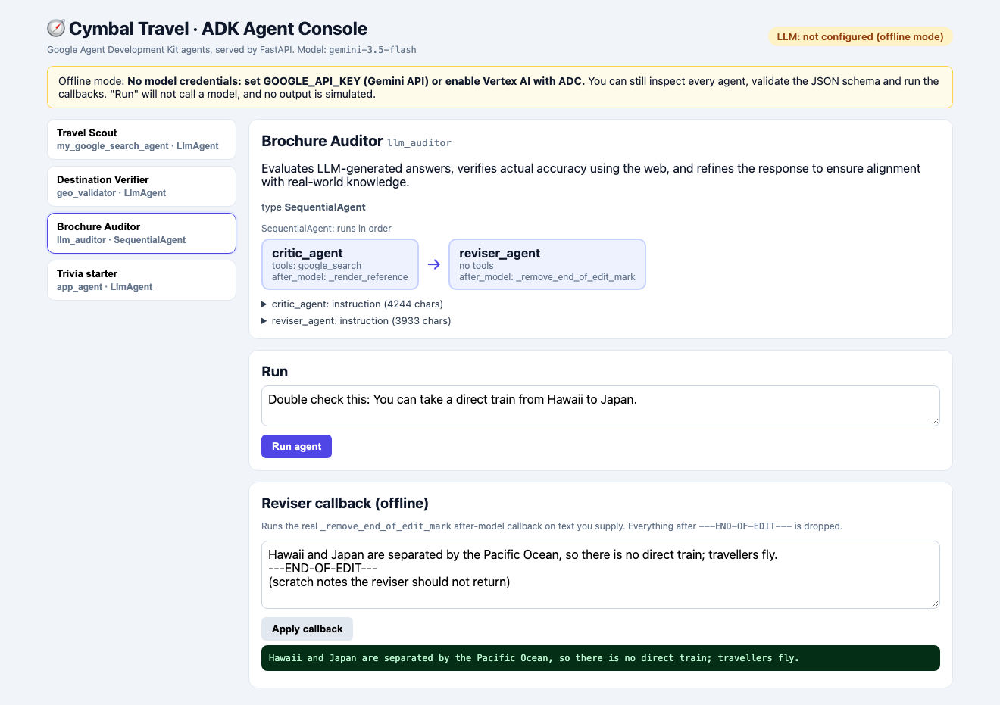
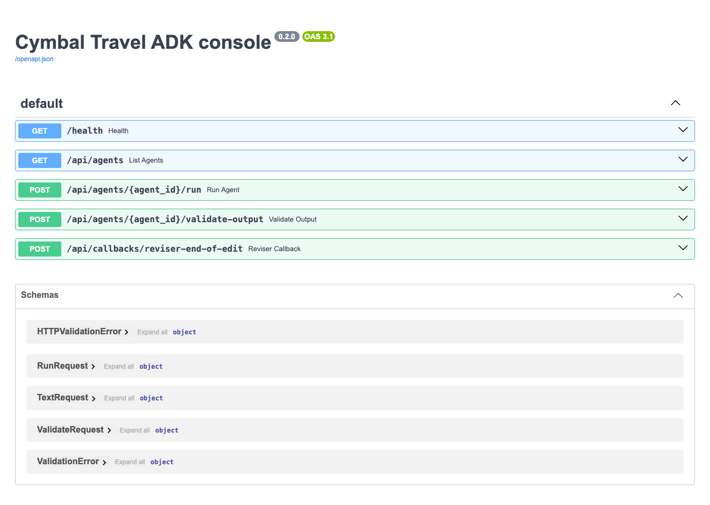

# 🧭 Cymbal Travel · ADK Agent Console

<p align="center"></p>

> Four Google **Agent Development Kit (ADK)** agents from a Cymbal Travel lab, packaged as a local app:
> a **FastAPI** backend plus a **React** console, started with one `docker compose up`.



---

## Business case

Teams trying AI agents often stall after the first demo. This console puts four Google ADK agent patterns for a travel business side by side (grounded search, structured output, a critic and reviser, and a minimal agent), and it behaves honestly without credentials. Its value is in choosing a pattern, not in the agents themselves. [docs/BUSINESS_CASE.md](docs/BUSINESS_CASE.md) covers the use cases, an illustrative ROI model and the limits.

## 1. What's inside

| Agent | ADK type | What it shows |
|---|---|---|
| **Travel Scout** `my_google_search_agent` | `LlmAgent` + `google_search` | Grounded web search for travel questions |
| **Destination Verifier** `geo_validator` | `LlmAgent` + `output_schema` | Structured JSON output (`CountryCapital`), no agent transfers |
| **Brochure Auditor** `llm_auditor` | `SequentialAgent` | Critic (search + references) → Reviser (strips its edit marker) |
| **Trivia starter** `app_agent` | `LlmAgent` | Minimal agent |

## 2. Architecture

<p align="center"></p>





## 3. Run it

```bash
cp .env.example .env        # optional: add GOOGLE_API_KEY
docker compose up --build
# console: http://localhost:3000   API docs: http://localhost:8000/docs
docker compose down
```

Vertex AI with your gcloud ADC (opt-in, mounts `~/.config/gcloud` read-only):

```bash
gcloud auth application-default login
GOOGLE_CLOUD_PROJECT=your-project docker compose -f docker-compose.yml -f docker-compose.vertex.yml up --build
```

Without Docker: `uv sync && uv run uvicorn server.api:app --reload`, then `cd frontend && npm ci && npm run dev`. `adk web` also works as before.

## 4. Offline mode (no key) ⚠️

**Every screenshot here was taken with no model credentials.** No agent output on this page was generated or simulated.

| Feature | No key | With key |
|---|---|---|
| Inspect agents, tools, schemas, pipeline | ✅ | ✅ |
| Validate JSON against `CountryCapital` | ✅ | ✅ |
| Run the reviser callback on your text | ✅ | ✅ |
| **Run agent** | ⏸ `503` "Not run", plus the reason | ✅ events from the real model |

When the key is wrong, the run returns `502` with Google's actual error (checked with a deliberately invalid key: `API_KEY_INVALID`).



### Schema check



### Auditor pipeline and reviser callback



### API

| Method | Path | Purpose |
|---|---|---|
| GET | `/health` | LLM status, model, agents |
| GET | `/api/agents` | Agent tree: model, instruction, tools, schema, callbacks |
| POST | `/api/agents/{id}/run` | Run with ADK (`503` when there are no credentials) |
| POST | `/api/agents/{id}/validate-output` | Validate JSON against the agent's `output_schema` |
| POST | `/api/callbacks/reviser-end-of-edit` | Apply the reviser callback |



## 5. Configuration

See [`.env.example`](.env.example): `GOOGLE_API_KEY`, or `GOOGLE_GENAI_USE_VERTEXAI` + `GOOGLE_CLOUD_PROJECT`/`LOCATION`, plus `MODEL` (default `gemini-3.5-flash`) and `ENABLE_CLOUD_LOGGING` (default off; previously a Cloud Logging client was created at import time and failed without GCP credentials).

## 6. Quality

- `uv run pytest`: offline tests for agent wiring, both callbacks, LLM status, 503 gating and schema validation.
- CI (`.github/workflows/ci.yml`): tests, then the frontend build, then `docker compose build`.
- Fix: the reviser callback crashed on parts with no text (`None in str`).

## 7. Repo map

```
app_agent/ geo_validator/ llm_auditor/ my_google_search_agent/   ADK agents (root_agent)
settings.py callback_logging.py                                  shared model + logging config
server/api.py                                                    FastAPI
frontend/                                                        React + Vite + TS (nginx)
tests/  scripts/screenshots.py  docs/
legacy/                                                          lab leftovers (moved, not deleted)
```

The original lab instructions are in [docs/ORIGINAL_README.md](docs/ORIGINAL_README.md).
